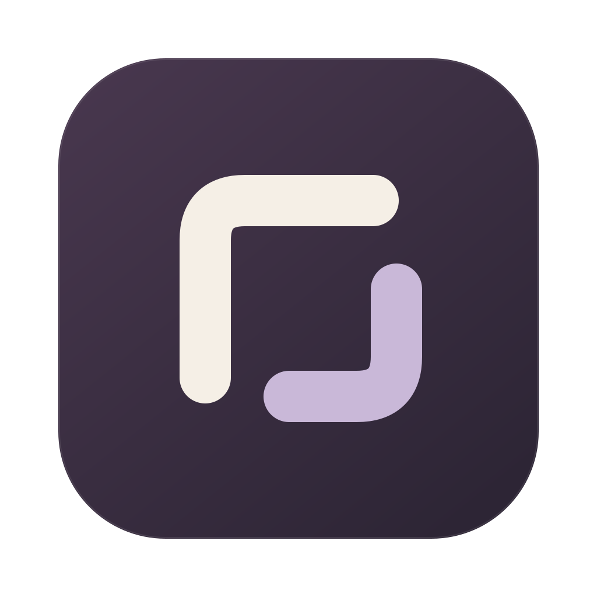

# Nook for Omarchy

Google Chat, Gmail, Drive and Calendar in one small Linux desktop app.

Built with Rust, GTK3 and Wry using the system WebKitGTK.

- Switch between four services without losing page state or drafts.
- Keep a dedicated, persistent Google session separate from your browser.
- Sign in within the main app window.
- Open Google documents and external links in your default browser.
- Use native file dialogs and desktop notifications.

## Build and install

Requires Omarchy or Arch Linux, Rust 1.89 or newer, WebKitGTK 4.1 version 2.40 or newer, and a graphical desktop session. Install the runtime and build dependencies if needed:

```sh
omarchy pkg add gtk3 webkit2gtk-4.1 gst-plugins-base gst-plugins-good librsvg xdg-utils rust pkgconf python base-devel
```

From the source directory:

```sh
export CARGO_TARGET_DIR="${XDG_CACHE_HOME:-$HOME/.cache}/nook-omarchy-build"
cargo build --release --locked
bash scripts/install-local.sh
nook-omarchy
```

The local installer adds the executable, launcher entry and icon under `~/.local`. Open **Nook** from your app launcher and sign in with your Google account. To run without installing, use `"$CARGO_TARGET_DIR/release/nook-omarchy"`.

The installer uses `$CARGO_TARGET_DIR/release`, defaulting to `${XDG_CACHE_HOME:-$HOME/.cache}/nook-omarchy-build/release`. You can pass a different build directory as its first argument.

### Arch package

```sh
bash scripts/package.sh
# Install the .pkg.tar.zst path printed by the script:
sudo pacman -U /absolute/path/to/nook-omarchy-0.0.1-1-x86_64.pkg.tar.zst
```

Packages are built from the current local source. Output goes to `${XDG_CACHE_HOME:-$HOME/.cache}/nook-omarchy-package`; override it with `NOOK_PACKAGE_DIR`, an absolute path outside the source tree. Use `bash scripts/package.sh --source-only` to prepare the release source archive, PKGBUILD and `.SRCINFO` without compiling. Choose either a local installation or an Arch package to avoid duplicate installations.

## Keyboard shortcuts

| Shortcut | Action |
| --- | --- |
| Ctrl+1 / 2 / 3 / 4 | Chat / Gmail / Drive / Calendar |
| Ctrl+R | Reload |
| Alt+Left | Back |
| Ctrl+Shift+H | Service home |
| Ctrl+, | Settings |
| Ctrl+Q | Quit |

Closing the window exits Nook. There is no tray process or autostart entry.

## Settings

Open **Settings** from the bottom-left menu or press **Ctrl+,**. Choose System, Light or Dark for Nook's sidebar and dialogs; Google websites have their own theme settings. Explicit Light and Dark use GTK's built-in Adwaita theme and do not change your desktop.

Chat and Gmail notifications can be enabled separately. Settings also control notification sound, sender/message previews and **Keep notifications until clicked or dismissed** (enabled by default). Persistent alerts use critical urgency and no expiration so Omarchy keeps them visible. Your desktop controls sound and may apply its own notification policy. Nook must remain running, and websites may withdraw their notifications. The test button uses saved settings and deliberately works even when service alerts are muted.

Save applies changes without reloading your Google session. Preferences are stored in `~/.config/nook-omarchy/settings.ini`, respecting `XDG_CONFIG_HOME`. Turning off a service withdraws its existing alerts; hiding previews also withdraws visible alerts that could contain private text.

## Data and removal

Nook stores WebKit website data in `~/.local/share/nook-omarchy/webkit` and its cache in `~/.cache/nook-omarchy/webkit`, respecting `XDG_DATA_HOME` and `XDG_CACHE_HOME`. It does not use your personal browser profile.

Remove a local installation with:

```sh
bash scripts/uninstall-local.sh
```

For an Arch package installation, use `sudo pacman -R nook-omarchy`. Both removal methods preserve website data and cache. Deleting the WebKit directories after closing Nook removes its local login data. The local uninstaller preserves installed files modified since installation.

## Limitations

**0.0.1 is an early preview.** Google sign-in, session restoration, all four services, organization-specific SSO, attachments and incoming Chat notifications still require real-account verification. Synthetic checks do not validate real Google workflows.

Paste through Ctrl+V and the native context menu is supported. Website requests to read the clipboard directly are blocked.

Notifications require Nook to be running. Service-worker Web Push has not been verified. Camera, microphone, screen sharing and broad filesystem APIs are not supported; ordinary file pickers are available.

## Development

Keep code, comments, UI and documentation in English. Keep tests, validation notes, browser data and generated files outside the source tree. Use synthetic fixtures and never log credentials, cookies, tokens or private web content.

Validate changes with a clean Cargo target directory, syntax-check each shell script and PKGBUILD with `bash -n`, and build a local package. Keep the four-service scope without a tray, autostart, updater, plugins or backend.

## License

Nook's code and assets are licensed under the [MIT License](LICENSE). Dependencies retain their own licenses. Package builds generate dependency notices and source links under `/usr/share/licenses/nook-omarchy/`.

GTK3, WebKitGTK and other system libraries are provided by the distribution under their respective licenses. No browser engine is bundled. Nook is not affiliated with Google.
